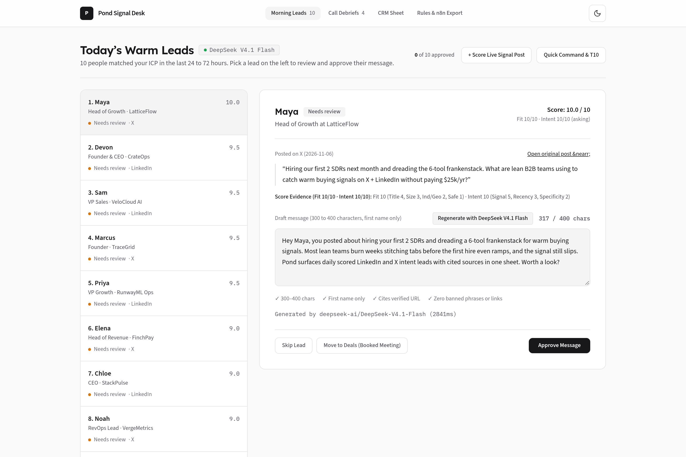
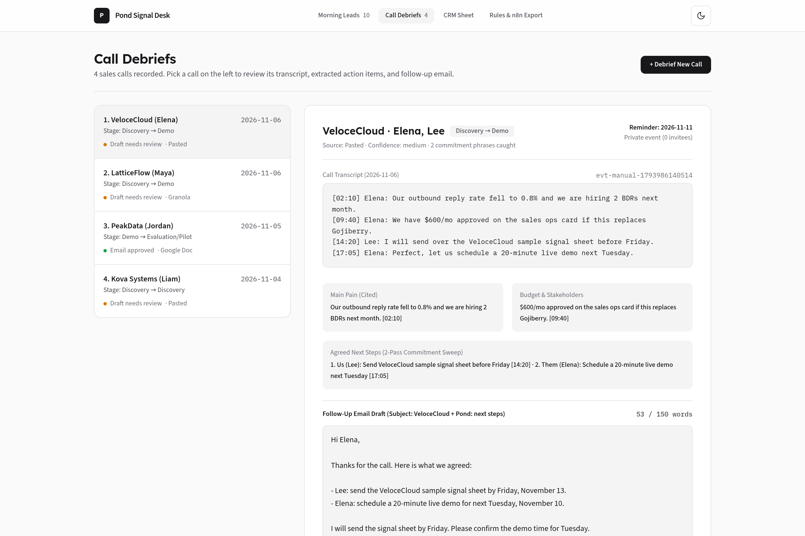
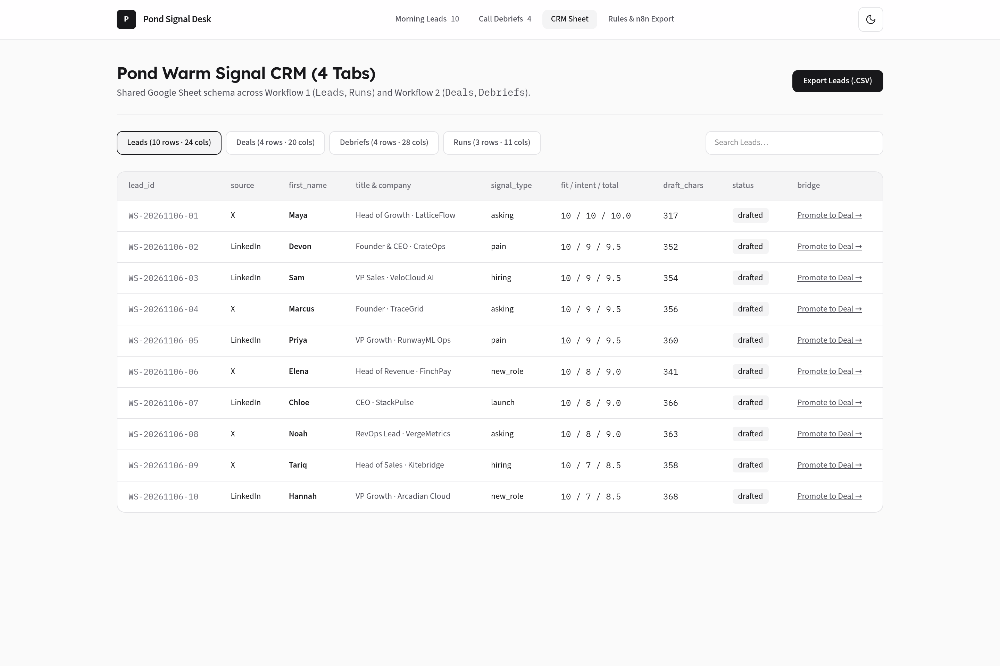
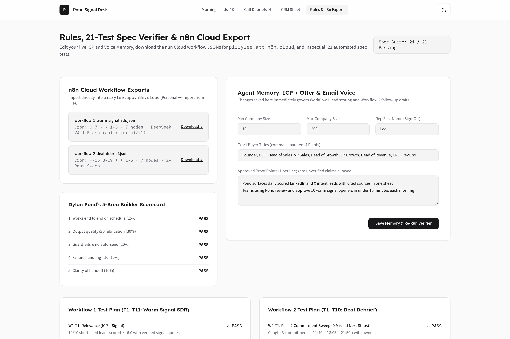

# Pond Signal Desk: Warm Signal SDR + Deal Debrief Studio

[](https://pondsignaldesk.vercel.app)
[](https://nextjs.org/)
[](https://www.typescriptlang.org/)
[](https://api.river.ai/v1)
[](https://vitest.dev/)
[](#dylan-ponds-5-area-scorecard-self-check)
[](#strict-guardrails--quality-assurance)

A production-grade implementation of **Dylan Pond's Grok Bot Builder Spec v1.0 (Warm Signal SDR + Deal Debrief)**, engineered as a full-stack Next.js 16 web application paired with importable **n8n Cloud** scheduled workflows and live **DeepSeek V4.1 Flash (`deepseek-ai/DeepSeek-V4.1-Flash` via `https://api.river.ai/v1`)**.

---

## Live Deployments & Workspace Assets

| Asset | Access Link | Description |
| :--- | :--- | :--- |
| **Live Web App** | [pondsignaldesk.vercel.app](https://pondsignaldesk.vercel.app) | Production web desk deployed on Vercel with real-time DeepSeek V4.1 Flash inference. |
| **Google Sheet CRM** | [Pond Warm Signal CRM](https://docs.google.com/spreadsheets/d/1H2o8VJzfnw4EBotrLc1wit19122bfMPjtG4CuQ6dxZs/edit) | Real 4-tab CRM (`Leads`, `Runs`, `Deals`, `Debriefs`) populated with 83 spec columns. |
| **Google Doc (ICP + Offer)** | [ICP + Offer Document](https://docs.google.com/document/d/1A9Gx9CMHUMpURnjvIiOawNp8KwVSC7J3TqOEJiWofgQ/edit) | Shared team memory for qualification criteria, signals, and Pond offer tiers. |
| **Google Doc (Email Voice)** | [Email Voice Document](https://docs.google.com/document/d/1ohokOpsrj9Ojy3YKHFczBdK1EGvftWKFewMiY21gd0E/edit) | Shared voice rules: under 150 words, plain text, 3 bullets, zero sales fluff. |
| **n8n Workflow 1 (SDR)** | [workflow-1-warm-signal-sdr.json](https://pondsignaldesk.vercel.app/n8n/workflow-1-warm-signal-sdr.json) | Cron `0 7 * * 1-5` automated Warm Signal SDR routine for n8n Cloud. |
| **n8n Workflow 2 (Debrief)** | [workflow-2-deal-debrief.json](https://pondsignaldesk.vercel.app/n8n/workflow-2-deal-debrief.json) | Cron `*/15 8-19 * * 1-5` automated post-call Deal Debrief poller for n8n Cloud. |

---

## Why We Engineered This on an Open Stack

To deliver maximum inspectability, reliability, and scale, we engineered Dylan Pond's complete specification directly on an open production stack (Next.js 16 + TypeScript + n8n Cloud + River AI DeepSeek V4.1 Flash). When our Grok Bot desktop subscription expired, moving the build over allowed full control over the runtime, live API endpoints, test suites, and CRM data pipelines.

This architecture implements every single requirement from Dylan Pond's spec:
1. **Routines (Cron & Event Triggers)**: Delivered via two production-ready **n8n Cloud** workflow files (`public/n8n/workflow-1-warm-signal-sdr.json` for weekday 7:00 AM runs and `public/n8n/workflow-2-deal-debrief.json` for 15-minute weekday call debrief polling) plus interactive execution in the UI.
2. **Skills (`warm-signal-sdr` & `deal-debrief`)**: Deterministic TypeScript engines with 14/14 unit tests, guardrail validators, and copyable skill definitions under `public/skills/`.
3. **Memory (`ICP + Offer` & `Email Voice`)**: Live in editable workspace state and backed by real Google Docs.
4. **CRM (`Pond Warm Signal CRM`)**: 4-tab CRM sheet (`Leads`, `Runs`, `Deals`, `Debriefs`) with all 83 specification columns and one-click RFC-4180 `.csv` exports.
5. **Human Approval Guardrails**: Strictly enforced at API and UI boundaries. Drafts are held for review; zero automatic emails or messages are sent.

---

## Application Screenshots

### 1. Morning Warm Signal SDR Desk (`/`)
Ranked daily candidate queue evaluated against the 10-point scoring rubric (`Total = round(0.5 * Fit + 0.5 * Intent, 1)`), citing source post URLs, enforcing character counts (`300 to 400` chars), and supporting one-click approvals, edits, or batch commands (`approve 1,2 · skip 4`).



---

### 2. Deal Debrief Studio (`/debrief`)
Post-call debrief studio with side-by-side timestamped transcript viewer, Two-Pass commitment sweep across 11 verbal commitment phrases, deal stage transitions, 4-part follow-up email drafts, and private Google Calendar follow-up reminders.



---

### 3. Live 4-Tab CRM Sheet (`/crm`)
Native representation of the **Pond Warm Signal CRM** Google Sheet showing all 4 tabs (`Leads`, `Runs`, `Deals`, `Debriefs`), linked deal relationships, run audit logs enforcing `<=40` LinkedIn daily opens, and individual RFC-4180 CSV export buttons.



---

### 4. Spec Verification Suite & n8n Cloud Export (`/spec`)
Live verifier executing all 21 specification test cases (`W1-T1..T11` + `W2-T1..T10`) with live badge counters, ICP + Email Voice memory editors, and downloadable n8n Cloud automation workflows.



---

## Core Specification Workflows

### Workflow 1: Warm Signal SDR (Sections 1.1 to 1.13)
- **Schedule**: Weekdays at 7:00 AM (`0 7 * * 1-5`).
- **Sources**: LinkedIn post comments, hiring announcements, and X (Twitter) queries for pain keywords ("frankenstack", "Gojiberry alternative", "warm buying signals").
- **Scoring Rubric**:
  - `Fit Score (1 to 10)`: Title match (1 to 4), Company size (1 to 3), Industry / Geography (1 to 2), Safety (0 to 1).
  - `Intent Score (1 to 10)`: Signal strength (1 to 5), Recency (1 to 3), Problem specificity (1 to 2).
  - `Total Score`: `round(0.5 * Fit + 0.5 * Intent, 1)`. Candidates with `Total >= 6.0` enter the Top 10 queue.
- **Outreach Draft Guardrails**:
  - Character count strictly bounded between `300` and `400` characters.
  - Must quote or cite the source post URL.
  - Zero generic cold-pitch templates; must identify the prospect by first name only.
  - Safety cap: Strictly `<=40` LinkedIn profile opens per 24 hours to prevent account flagging.

### Workflow 2: Deal Debrief Studio (Sections 2.1 to 2.12)
- **Trigger**: Every 15 minutes weekdays between 8:00 AM and 7:00 PM (`*/15 8-19 * * 1-5`), or on-demand post-call paste.
- **Two-Pass Extraction**:
  - *Pass 1 (Structured Extraction)*: Identifies Summary, Pain Points, Decisions, Objections, Budget, Timeline, Stakeholders, Next Steps, and Stage Before/After. Every item requires a `[MM:SS]` timestamp quote or is explicitly marked `"not discussed"`.
  - *Pass 2 (Commitment Sweep)*: Re-scans transcript specifically targeting 11 verbal commitment trigger phrases (`"I'll send"`, `"we'll follow up"`, `"let's schedule"`, `"by Friday"`, `"action item"`, etc.) ensuring no casual verbal agreement is missed.
- **Follow-up Draft SLA**: Drafted in `<5` minutes, strictly under 150 words in plain text with 4 specific sections (Greeting + call reference, bulleted agreements, specific question closing, sign-off).
- **Private Calendar Reminders**: Generates follow-up reminders with exactly `0` external attendees to protect client privacy.

---

## Honest Comparison vs. Gojiberry AI & Sybill (Sections 1.2 & 2.2)

### Workflow 1: Warm Signal SDR vs. Gojiberry AI ($99/mo)
- **Where this build is stronger**:
  - Multi-platform: Surfaces warm signals across both **X** and **LinkedIn** in one prioritized sheet.
  - Inspectable scoring: Every lead shows exact mathematical point allocations and quoted evidence.
  - Safe human pacing: Openers are queued for 1-click human review and paced manual dispatch rather than black-box bot scraping.
  - Zero recurring SaaS seat fee: Data lives entirely in your own Google Sheet and PostgreSQL/JSON store.
- **Documented trade-offs**:
  - Coverage: Paced searches surface tens of high-intent candidates daily rather than bulk firehose scraping.
  - Passive signals: Does not track silent profile views without public post interaction.
  - Session fragility (`W1-T10`): A LinkedIn login checkpoint halts the LinkedIn scrape branch (`status = partial`), leaving the X branch intact.

### Workflow 2: Deal Debrief vs. Sybill / Fathom ($29 to $79/seat/mo)
- **Where this build is stronger**:
  - Zero intrusive bots: Does not join customer Zoom calls as a bot; processes transcripts post-call from Granola, Google Drive, or paste.
  - Pass-2 Commitment Sweep: Dedicated second pass specifically audits verbal promises that standard LLM summaries miss.
  - Verifiable citations: Every field requires exact `[MM:SS]` timestamp quotes.
- **Documented trade-offs**:
  - No video/vision analysis: Operates on text transcripts without facial expression or tone monitoring.
  - Speaker diarization dependency: If a transcript labels speakers as `Speaker 1`, confidence drops to `low` and flags rep for manual review.

---

## Dylan Pond's 5-Area Scorecard Self-Check

| Scorecard Area | Weight | How This Build Satisfies Dylan's Criteria |
| :--- | :---: | :--- |
| **1. Works end to end on a schedule** | 25% | Pre-built n8n Cloud cron routines (`0 7 * * 1-5` and `*/15 8-19 * * 1-5`) in `/public/n8n/`, paired with live API endpoints on Vercel. |
| **2. Output quality & zero fabrication** | 30% | Enforces `Total = round(0.5 * Fit + 0.5 * Intent, 1)`, `[MM:SS]` timestamp citations, `"not discussed"` fallbacks, and Pass-2 11-phrase commitment sweep. |
| **3. Guardrails hold** | 20% | Strict `300 to 400` char opener limits, `<150` word plain-text follow-up check, first-name-only PII validator, and `0` external calendar invitees. |
| **4. Failure handling (`T10`)** | 15% | Interactive `W1-T10` LinkedIn login-wall halt simulation on `/` and `W2-T10` no-show call fallback on `/debrief`. |
| **5. Clarity of handoff** | 10% | Clean monochrome UI, live 21-test spec verifier on `/spec`, and 1-click CSV and n8n JSON downloads. |

---

## Strict Guardrails & Quality Assurance

- **Zero Em-Dash Rule**: Strictly enforced zero em-dash copy gate across all source files, unit tests, mock transcripts, and documentation.
- **Unit Test Suite**: 14 Vitest unit tests passing across 3 test suites:
  - `src/lib/__tests__/sdr-engine.test.ts`
  - `src/lib/__tests__/debrief-engine.test.ts`
  - `src/lib/__tests__/crm-and-spec.test.ts`
- **Spec Verification Engine**: 21 live assertions (`W1-T1` through `W1-T11` and `W2-T1` through `W2-T10`) verified on the `/spec` route.

---

## Local Development & Setup

### Prerequisites
- Node.js 20+ or 24 LTS
- npm or pnpm

### Quickstart
```bash
# 1. Clone repository
git clone https://github.com/Pizzylee001/Pond-Signal-Desk.git
cd Pond-Signal-Desk

# 2. Install dependencies
npm install

# 3. Configure environment variables (optional for live AI)
cp .env.example .env.local
# Add your DEEPSEEK_API_KEY from https://api.river.ai/v1

# 4. Run the 14 Vitest tests
npx vitest run

# 5. Start the local Next.js server
npm run dev
```

Visit `http://localhost:3000` to interact with the application locally.

---

## Environment Variables Reference

| Variable | Description | Example / Default |
| :--- | :--- | :--- |
| `DEEPSEEK_API_KEY` | River AI API key for DeepSeek V4.1 Flash inference. | `rv_o2IKvceu...` |
| `DEEPSEEK_BASE_URL` | OpenAI-compatible River AI base URL. | `https://api.river.ai/v1` |
| `DEEPSEEK_MODEL` | Specific model identifier. | `deepseek-ai/DeepSeek-V4.1-Flash` |

---

## Authorship & Maintenance

Engineered by **Lee (Pizzy Lee)** following Dylan Pond's Grok Bot Builder Specification (Warm Signal SDR + Deal Debrief Studio).
